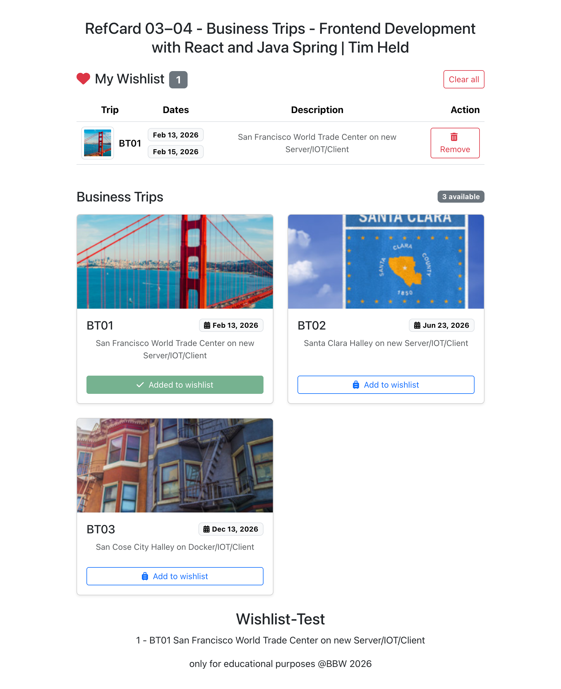
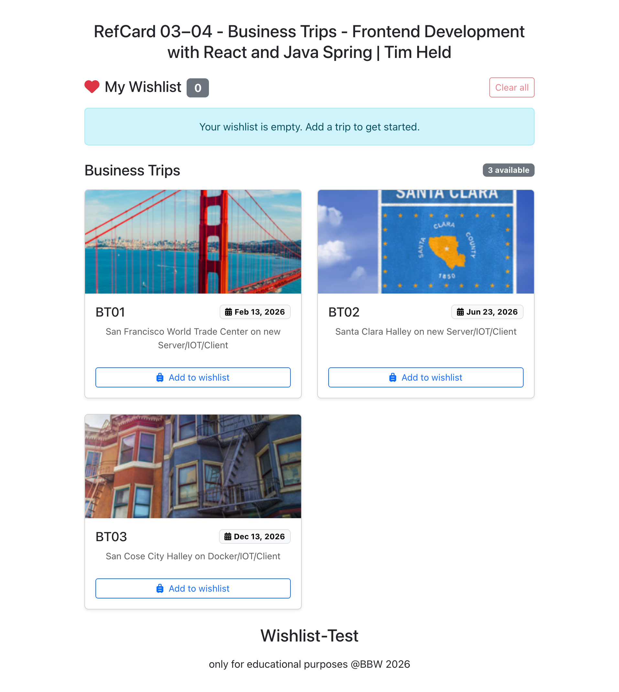
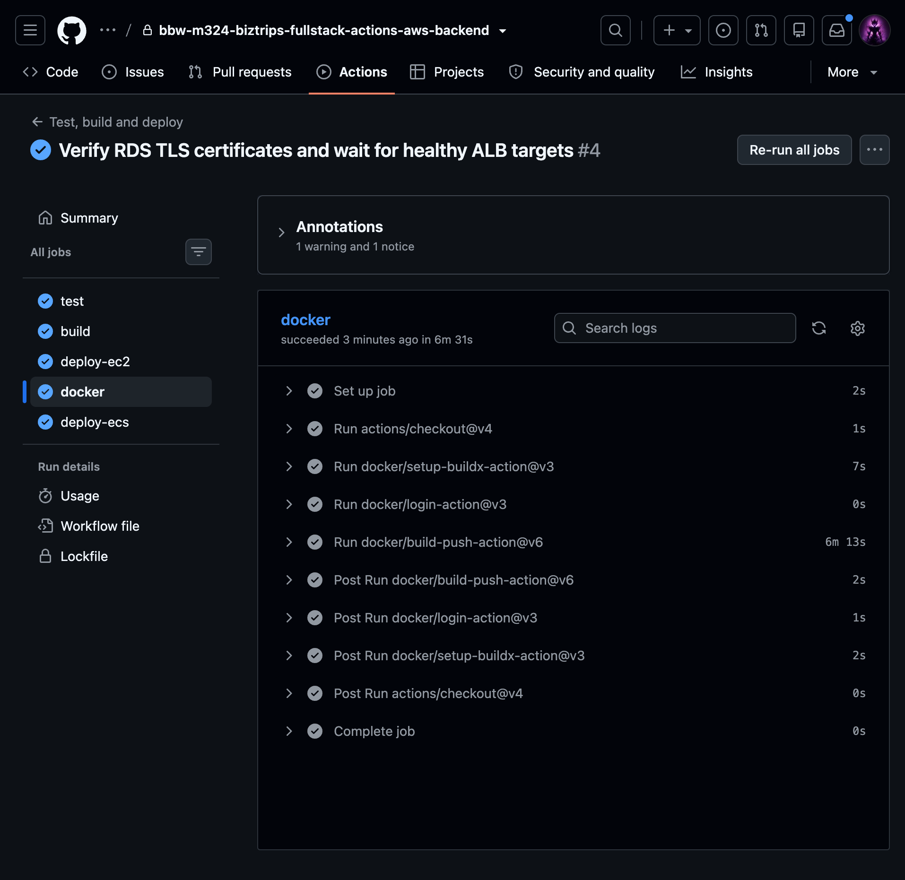
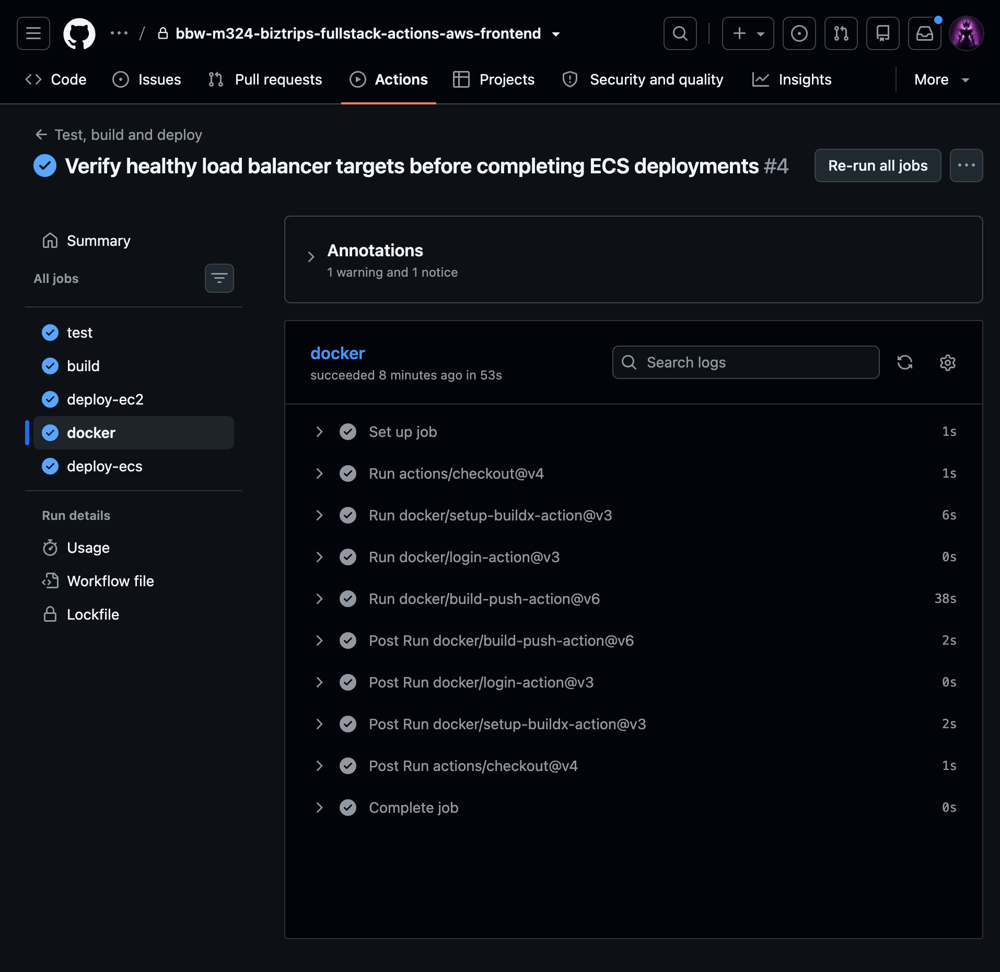
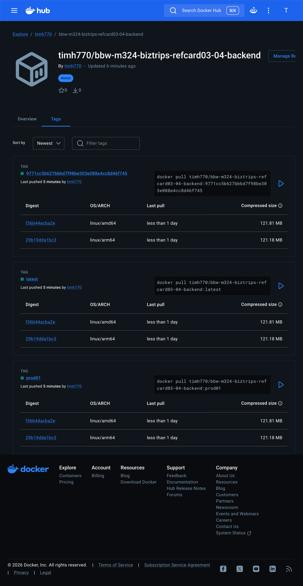
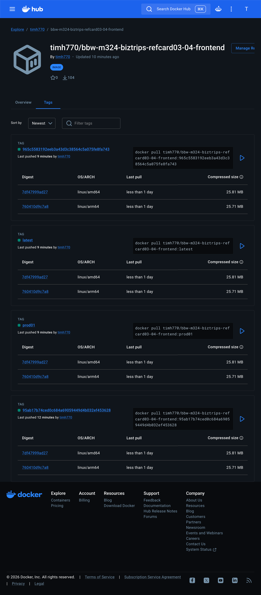
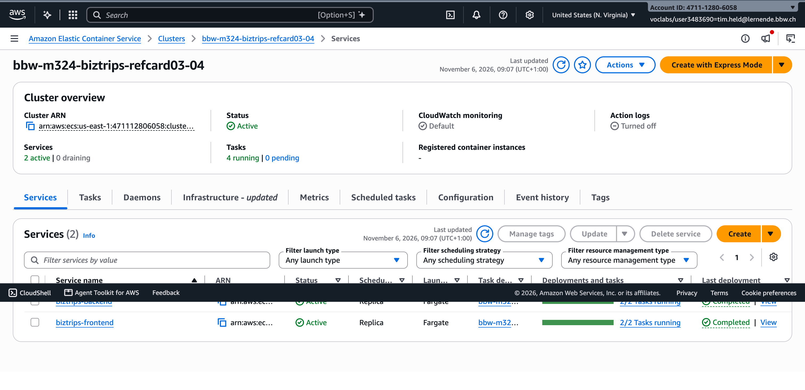
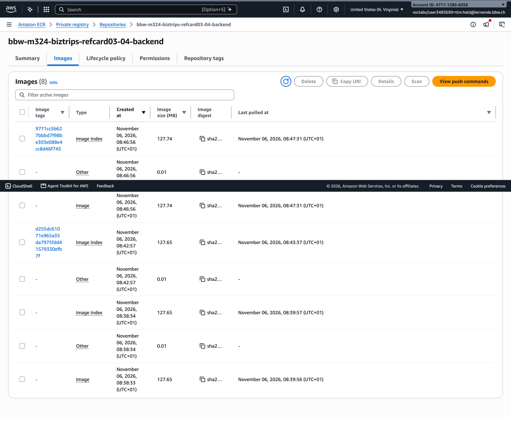
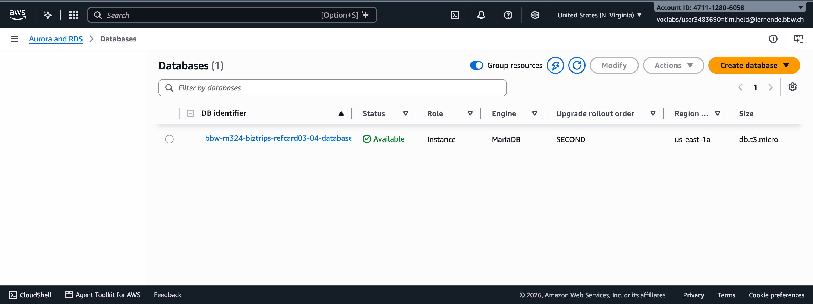

# RefCard03–04 · Umsetzung und Nachweise

**Autor:** Tim Held · **Modul:** M324 · **Datum:** 06.11.2026

## Ausgangspunkt

Backend: `bbwlc/RefCard-03-be-SpringBootBusinessTrips`, Tag `v1-start`, Commit `e98f4afc1c0f9560682f8c25f6be07e620d49163`.
Frontend: `bbwlc/refcard-03-fe-react-vite`, Tag `v1-start`, Commit `ac9bf587aef94cfad1408540b9ee1eb77eecd3f0`.
Die Historie bleibt erhalten; die Lehrer-Repositories sind als `upstream` eingetragen. Eigene Arbeit liegt auf `main` in zwei neuen privaten Repositories.

## Stand der Übungen

| Übung | Implementierung | Bisher tatsächlich geprüft |
|---|---|---|
| EX-01 · EC2 und GitHub Actions | Getrennte Jobs für Test, Build und Deployment; Artefakte; gepinnter SSH-Hostkey; Healthcheck; Backend-Rollback; native MariaDB und systemd | Beide Live-Pipelines grün; Frontend/API auf EC2 mit HTTP 200; Hostkey gegen AWS-Bootausgabe geprüft |
| EX-02 · Docker Hub | Zwei Multi-Stage-Images; Tags `prod01`, `latest`, Commit-SHA; Veröffentlichung nur auf `main`; Buildx-Cache | Beide Images mit drei Tags veröffentlicht, erneut von Docker Hub gezogen und lokal mit MariaDB gesund gestartet |
| EX-03 · ECR, ECS, ALB, RDS | Infrastruktur als CloudFormation; private DB; zwei Services mit je zwei Tasks; Healthchecks; Circuit Breaker; Abgleich der tatsächlich laufenden Task-Revision | Stack vollständig erstellt; beide Services mit je zwei gesunden Tasks; vier gesunde ALB-Targets; erfolgreiche automatische Deployments beider Repos |
| EX-04 · Mitarbeiterfotos | Upload/Download; PNG/JPEG/WebP; 5 MiB; Signaturprüfung; UUID; Pfadprüfung; korrekter Content-Type; persistentes Volume; dauerhafter EC2-Pfad | Upload/Download und Negativfälle erfolgreich; identische Fotos nach lokaler Containerersetzung, Registry-Pull und automatisiertem EC2-Redeploy |

Die Abnahme basiert auf den unten verlinkten erfolgreichen Workflow-Runs, Browser-Screenshots und den gespeicherten AWS-/HTTP-Abfragen. Der letzte Code-Stand ist separat von der abschliessenden Dokumentation versioniert.

Details: [Technische Entscheidungen](UMSETZUNG.md), [beantwortete Reflexionsfragen](REFLEXION.md) und [Originalauftrag](AUFTRAG.md).

## Lokale Prüfungen

- Backend: vier JUnit-Tests erfolgreich, inklusive Storage-Sicherheitsfällen und Spring-Kontext.
- Frontend: vier Vitest-Tests erfolgreich, inklusive API-Fehler und Hinzufügen/Entfernen eines Trips in der Wishlist. Produktions-Build erfolgreich. ESLint ohne Fehler, eine vorhandene Fast-Refresh-Warnung im Context-Modul.
- Docker: Multi-Stage-Images für Backend und Frontend erfolgreich gebaut.
- Compose: MariaDB, Backend und nginx melden `healthy`.
- API über nginx: `/v1/trips` antwortet mit HTTP 200 und drei Trips.
- Upload/Download: PNG-Datei wird mit HTTP 200 und `image/png` ausgeliefert; Bytes stimmen überein.
- Negativfälle: falscher deklarierter MIME-Type und falsche Bildsignatur liefern 400, unbekannter Mitarbeiter 404, Datei über 5 MiB 413.
- Containerersetzung: `docker compose up -d --force-recreate --wait backend`; Bild weiterhin verfügbar, unveränderte Bytes und Datenbankreferenz.
- SHA256 des Testbilds: `4c5d573cfb85b8ab0a5659062b830a058d1a449e51a6d79c13b483a77ea7ed28`.

## Live-Abnahme

| Ziel | Adresse / Version | Ergebnis |
|---|---|---|
| EC2 | <http://13.220.4.150> | Frontend, drei Trips und Fotodownload erfolgreich |
| ECS/ALB | <http://bbw-m324-Alb-BD6YtmTDd85r-713603972.us-east-1.elb.amazonaws.com> | Frontend und API erfolgreich; Actuator meldet `UP` |
| Backend | Commit `9771cc5b627bbbd7f98be303e088e4cc8d46f745`, Task-Revision 3 | Alle fünf Jobs erfolgreich |
| Frontend | Commit `965c5583192eeb3a43d3c38564c5a075fe8fa743`, Task-Revision 3 | Alle fünf Jobs erfolgreich |

- [Backend-Run: Test, Build, EC2, Docker Hub, ECS](https://github.com/AdminGodZ/bbw-m324-biztrips-fullstack-actions-aws-backend/actions/runs/42182939634)
- [Frontend-Run: Test, Build, EC2, Docker Hub, ECS](https://github.com/AdminGodZ/bbw-m324-biztrips-fullstack-actions-aws-frontend/actions/runs/42182874967)
- [Backend-Images auf Docker Hub](https://hub.docker.com/r/timh770/bbw-m324-biztrips-refcard03-04-backend/tags)
- [Frontend-Images auf Docker Hub](https://hub.docker.com/r/timh770/bbw-m324-biztrips-refcard03-04-frontend/tags)
- [AWS-, Registry- und CI-Abfrage mit Zeitstempel](evidence/live-state.json)
- [HTTP- und Persistenzabnahme mit SHA256](evidence/http-and-persistence.json)
- [Tatsächlich registrierte Backend-Task-Definition](../task-definition.json). Die Pipeline rendert neue Definitionen aus den Stack-Ausgaben; diese Datei dokumentiert die abgenommene Revision und enthält nur die Secret-ARN, kein Passwort.

Die Backend-Docker-Hub-Tags `prod01`, `latest` und der volle Commit-SHA zeigen auf den Index-Digest `sha256:7df27e7e1d0f83325c79ebeca485a4ee37599983f6d7e4876b7d5df0b93a50e0`. Beim Frontend ist es `sha256:d2d63210bdabea777dd7e6b56cdfe672bc684a8f3a5c1a0cf25d0f9d734f7a9b`. Beide Veröffentlichungen enthalten amd64- und arm64-Images. Die ECR-Images sind jeweils mit demselben Quellcode-Commit getaggt; ihr Digest kann abweichen, da dort ein separater amd64-Build veröffentlicht wird.

### Beobachteter Fehler und Korrektur

Der erste ECS-Backend-Start scheiterte, weil die aktuelle RDS-MariaDB-Konfiguration unverschlüsselte Verbindungen ablehnt. Die CloudWatch-Meldung lautete `Connections using insecure transport are prohibited`. Im Commit `9771cc5` wurde die JDBC-URL um `sslMode=verify-full` und `serverSslCert=/app/rds-ca-bundle.crt` ergänzt. Das Runtime-Image enthält die öffentliche [AWS-RDS-CA-Sammlung](https://truststore.pki.rds.amazonaws.com/global/global-bundle.pem). Damit werden Zertifikatskette und Hostname geprüft. Die Schutzvorgabe der Datenbank bleibt aktiv.

Die erste reine ECS-Stabilitätsabfrage hatte zudem noch keinen erfolgreichen externen HTTP-Aufruf garantiert. Die Pipeline wartet deshalb zusätzlich auf `elbv2 target-in-service` und prüft erst danach HTTP 200. Der anschliessende Run ist vollständig grün, beide Backend-Targets sind gesund und `/v1/trips` liefert exakt die drei Demo-Trips. Die Korrektur und ihre Wirkung sind in Commit, Logs und erfolgreichem Folgerun nachvollziehbar.

### Browser-Screenshots

EC2 mit individuellem Titel und getesteter Wishlist:

ECS über den Application Load Balancer:

Backend-Pipeline mit allen fünf erfolgreichen Jobs:

Frontend-Pipeline mit allen fünf erfolgreichen Jobs:

Veröffentlichte Backend-Tags:

Veröffentlichte Frontend-Tags:

AWS-Konsole mit zwei aktiven Services und vier laufenden Tasks:

ECR mit dem Commit-Tag der abgenommenen Backend-Version:

RDS-MariaDB mit Status `Available`:

## Betrieb nach der Abnahme

Die Lab-Zugangsdaten laufen ab. Für einen späteren Deploy den vollständigen `AWS_CREDENTIALS`-Block in beiden Repos erneuern. Der Docker-Hub-Token wurde mit Read/Write und Ablauf nach 30 Tagen angelegt. Für einen späteren Push nach seinem Ablauf ist ebenfalls eine Erneuerung nötig.

Die AWS-Ressourcen bleiben zur Kontrolle bestehen. Fargate-Tasks, ALB und RDS benötigen Lab-Budget; ein Ende der Lab-Session ist kein vollständiger Abbau dieses Stacks. Die API-Adressen und EC2-SSH-IP können sich nach Stop/Start ändern. Dann zuerst die aktuelle Adresse und den Hostkey prüfen und die Environment-Secrets anpassen.
