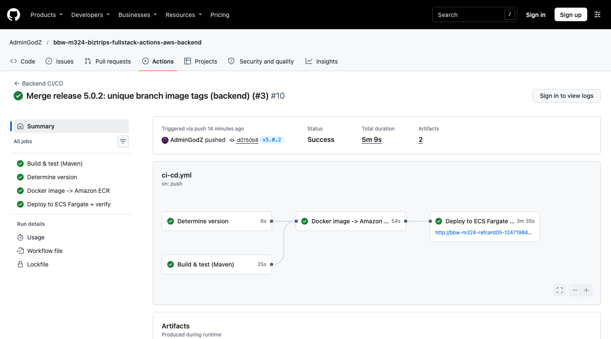
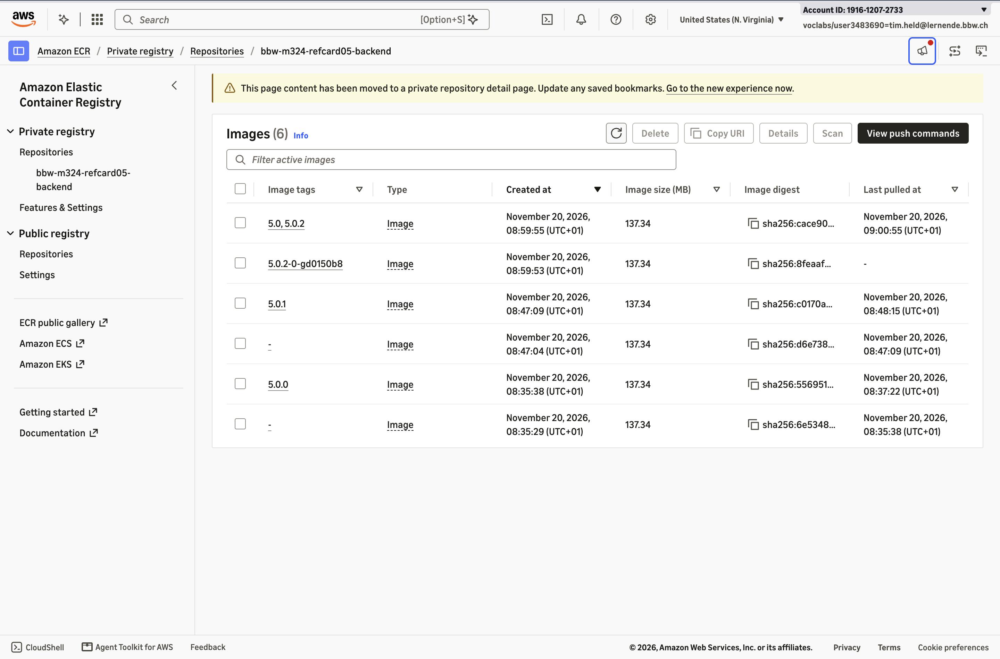
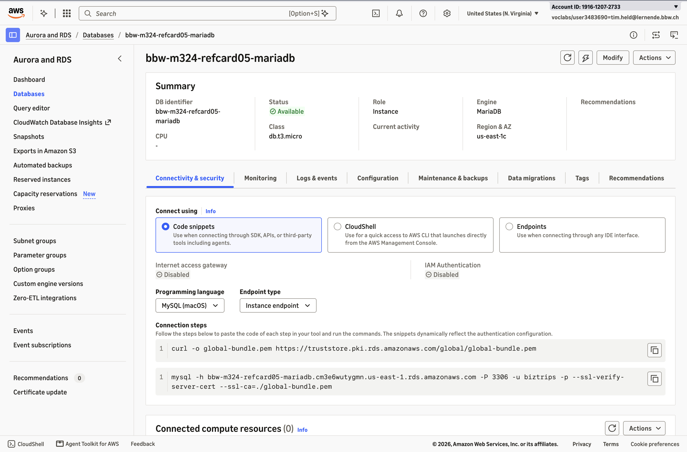
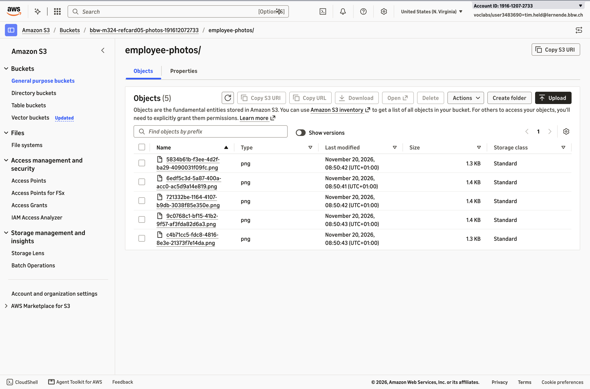
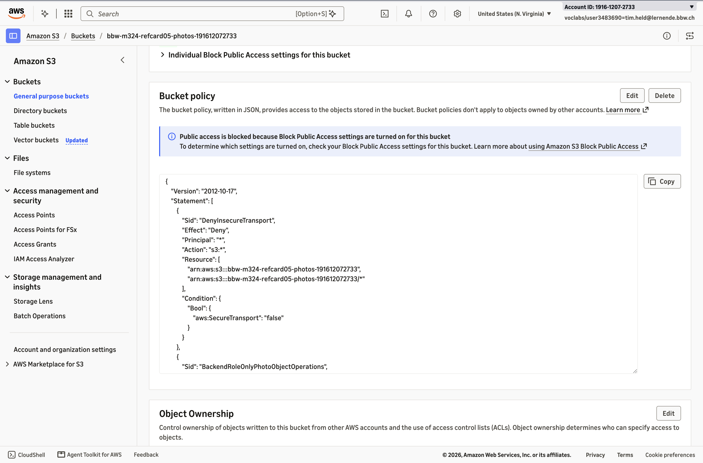
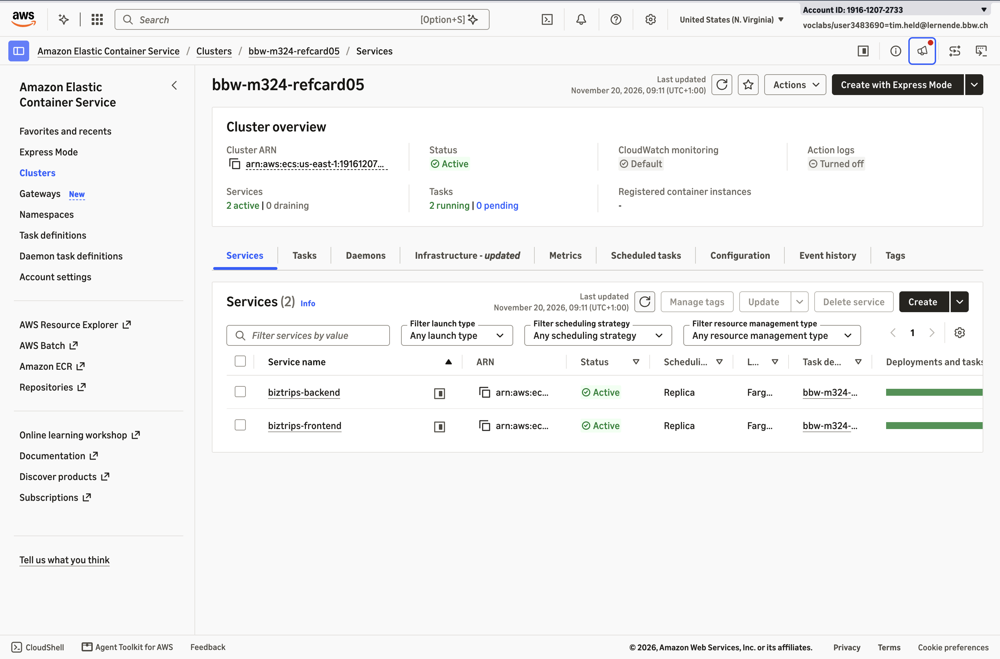
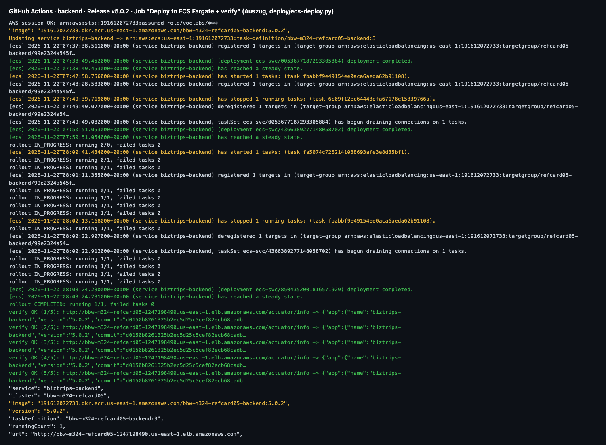
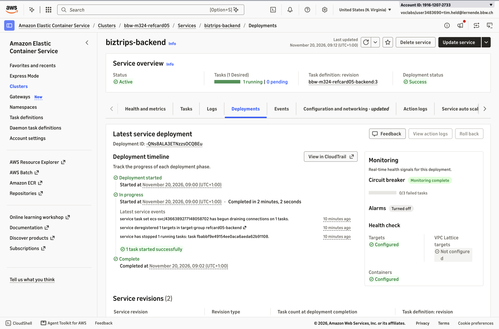
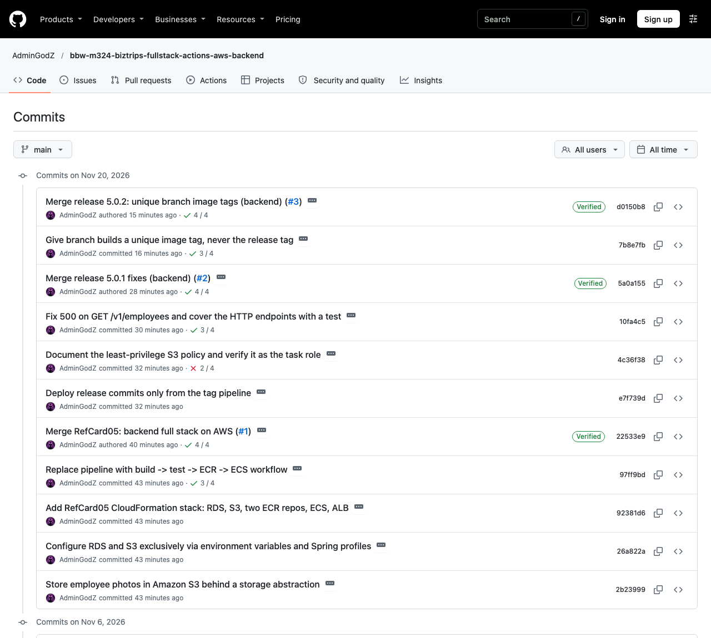
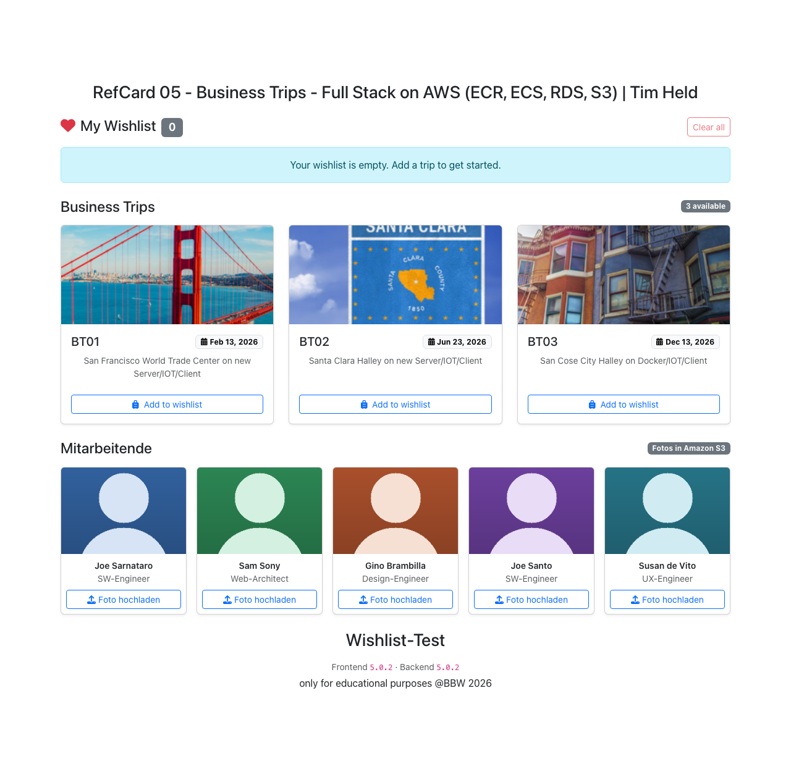

# RefCard05 · Backend · Full Stack auf AWS (ECR, ECS, RDS, S3)

**Autor:** Tim Held · **Modul:** M324 · **Datum:** 20.11.2026 · **Release:** `v5.0.2`

| Repository | Inhalt |
|---|---|
| **Backend (dieses Repo)** | Spring Boot, RDS-Anbindung, S3-Bilder-Storage, Infrastruktur (CloudFormation), Pipeline |
| [Frontend](https://github.com/AdminGodZ/bbw-m324-biztrips-fullstack-actions-aws-frontend) | React + Vite hinter nginx, Pipeline, [Doku](https://github.com/AdminGodZ/bbw-m324-biztrips-fullstack-actions-aws-frontend/blob/main/docs/REFCARD05.md) |
| [Compose](https://github.com/AdminGodZ/bbw-m324-biztrips-fullstack-compose) | Lokale Entwicklung (Frontend + Backend + MariaDB + S3-Mock), Gesamtübersicht |

Live: <http://bbw-m324-refcard05-1247198490.us-east-1.elb.amazonaws.com> (läuft nur, solange die Learner-Lab-Session aktiv ist).

## Architektur

```mermaid
flowchart LR
  dev[Push / Tag vX.Y.Z] --> ghaB[GitHub Actions<br/>Backend-Pipeline]
  dev --> ghaF[GitHub Actions<br/>Frontend-Pipeline]
  ghaB -->|Image 5.0.2| ecrB[(ECR<br/>refcard05-backend)]
  ghaF -->|Image 5.0.2| ecrF[(ECR<br/>refcard05-frontend)]
  ghaB -->|neue Task-Definition| svcB
  ghaF -->|neue Task-Definition| svcF
  user((Browser)) --> alb[Application Load Balancer]
  subgraph ECS Fargate · Cluster bbw-m324-refcard05
    svcF[Service biztrips-frontend<br/>nginx]
    svcB[Service biztrips-backend<br/>Spring Boot]
  end
  alb -->|/| svcF
  alb -->|/v1/*, /actuator/*| svcB
  svcB -->|TLS verify-full| rds[(RDS MariaDB 11.8)]
  svcB -->|Task-Rolle, nur employee-photos/*| s3[(S3 Bucket<br/>Fotos)]
  sm[Secrets Manager] -.->|DB_USER, DB_PASSWORD| svcB
```

Die gesamte AWS-Infrastruktur ist Code: [`deploy/infrastructure.yaml`](../deploy/infrastructure.yaml) (Stack `bbw-m324-refcard05`). Er enthält Security Groups (DB nur von den Tasks, Tasks nur vom ALB), RDS, Secret, S3-Bucket inklusive Policy, zwei ECR-Repositories mit Scan-on-Push und Lifecycle-Regeln, den ECS-Cluster, CloudWatch Logs und den ALB mit Pfad-Routing. Die ECS-Services und Task-Definitionen legt die Pipeline selbst an und aktualisiert sie.

```bash
aws cloudformation deploy --stack-name bbw-m324-refcard05 --template-file deploy/infrastructure.yaml \
  --parameter-overrides VpcId=vpc-… Subnets=subnet-a,subnet-b,subnet-c CreateTaskRole=false
```

## 1 · CI/CD-Pipeline: build → test → Image → ECR → ECS

Datei: [`.github/workflows/ci-cd.yml`](../.github/workflows/ci-cd.yml)

| Job | Aufgabe | Robustheit |
|---|---|---|
| `Build & test (Maven)` | `./mvnw verify` mit 17 Tests (S3-Storage mit gemocktem Client, Fehlerfälle, Health, HTTP-Endpunkte, Spring-Kontext) | Maven-Cache (`setup-java cache: maven`), Testtabelle in der Job-Summary, Surefire-Reports als Artefakt |
| `Determine version` | SemVer aus dem Git-Tag (siehe Abschnitt 2) | bricht bei Tags ab, die nicht `vMAJOR.MINOR.PATCH` sind |
| `Docker image -> Amazon ECR` | Multi-Stage-Dockerfile (Maven/JDK → JRE Alpine), Push nach ECR, Kontrolle mit `aws ecr describe-images` | BuildKit-Layer-Cache (`type=gha`), auf PRs nur Build ohne Push und ohne AWS-Zugang |
| `Deploy to ECS Fargate + verify` | `deploy/ecs-deploy.py`: Task-Definition registrieren, Service aktualisieren, Rollout abwarten, Version über den ALB prüfen | `concurrency: ecs-backend` (nie zwei Rollouts gleichzeitig), Circuit Breaker mit Rollback, klare `::error::`-Meldungen |

Auslöser: Pull Requests (nur Build und Test), Push auf `main` (Deploy der Entwicklungsversion), Tag `v*.*.*` (Release-Deploy). Reine Doku-Commits (`docs/**`, `*.md`) lösen keinen Deploy aus.

Aussagekräftige Fehlermeldungen (Beispiele):

- Fehlende Secrets: `GitHub secrets missing: Not set: AWS_SESSION_TOKEN …`
- Abgelaufene Lab-Session: `Learner Lab session expired or invalid` mit Anleitung zur Erneuerung
- Fehlgeschlagener Rollout: `rollout FAILED (…) Stopped task reasons: […]. ECS rolled back to the previous version. Check CloudWatch log group /ecs/bbw-m324-refcard05.`



## 2 · Versionierung mit Git-Tags (SemVer)

| Ereignis | Version | ECR-Image-Tags | Deploy |
|---|---|---|---|
| Tag `v5.0.2` | `5.0.2` | `5.0.2`, `5.0` | ja (Release) |
| Push auf `main` | `git describe --long`, z. B. `5.0.2-3-g1a2b3c4`, auf einem Release-Commit `5.0.2-0-gd0150b8` | gleich wie die Version | ja (Entwicklungsstand); auf einem Release-Commit übersprungen |
| Pull Request | wie `main` | – (kein Push) | nein |

- **Ein gemeinsames Schema für beide Repos:** Major `5` steht für RefCard05. Frontend und Backend werden gemeinsam als `v5.0.0`, `v5.0.1` und `v5.0.2` released, die Compose-Submodule zeigen auf denselben Tag.
- **Nachvollziehbarkeit vom Tag bis zum laufenden Container:** Git-Tag → ECR-Tag → OCI-Labels `org.opencontainers.image.version` und `org.opencontainers.image.revision` (Commit) → ECS-Task-Definition (Tag `Version`, Docker-Label) → zur Laufzeit `/actuator/info` (`app.version`, `app.commit`). Im Frontend-Footer stehen beide laufenden Versionen.
- **Schutz für Releases:** Ein Merge auf `main` und der Release-Tag auf demselben Commit starten zwei Pipelines. Der `main`-Lauf überspringt seinen Deploy, wenn der Commit bereits einen Release-Tag trägt, und pusht sein Image unter einem eigenen Tag (`-0-g<sha>`). Ein Release-Image wird so nie überschrieben (siehe [Probleme](#9--probleme-und-lösungen)).

| Release | Inhalt |
|---|---|
| `v5.0.0` | S3-Storage, RDS-Anbindung, Infrastruktur, neue Pipeline |
| `v5.0.1` | Fix der Mitarbeitendenliste auf ECS, Release-Schutz in der Pipeline, Least-Privilege-Nachweis |
| `v5.0.2` | eindeutige Image-Tags für Branch-Builds (`git describe --long`) |



Die zwei Images ohne Tag stammen aus den `main`-Läufen der Releases 5.0.0 und 5.0.1. Das Problem ist in v5.0.2 behoben (siehe §9), seither hat der `main`-Build einen eigenen Tag (`5.0.2-0-gd0150b8`). Die Lifecycle-Regel des Repositories löscht ungetaggte Images nach 3 Tagen.

## 3 · Anbindung an RDS MariaDB (Konfiguration über Secrets)

Die Verbindungsdaten kommen ausschliesslich aus Umgebungsvariablen. Im Code und im Repository stehen keine Zugangsdaten.

| Variable | Quelle auf ECS |
|---|---|
| `DB_HOST`, `DB_PORT`, `DB_NAME` | Task-Definition, gerendert aus den CloudFormation-Outputs |
| `DB_USER`, `DB_PASSWORD` | ECS-`secrets` → **AWS Secrets Manager** `bbw-m324-refcard05/rds-biztrips` (Passwort von CloudFormation generiert, 32 Zeichen). Die Werte sind in der Task-Definition nicht sichtbar. |

**Getrennte Spring-Profile:**

| Profil | Verwendung | Datenbank | Fotos |
|---|---|---|---|
| *(keins)* | Tests, `./mvnw spring-boot:run` | H2 in-memory | lokales Verzeichnis |
| `mariadb` | Docker Compose | MariaDB-Container | `APP_STORAGE_TYPE` (Compose: S3-Mock) |
| `aws` | ECS Fargate | RDS, TLS `sslMode=verify-full` gegen das RDS-CA-Bundle | Amazon S3 |

Das Profil `aws` ([application-aws.properties](../src/main/resources/application-aws.properties)) hat absichtlich **keine Default-Werte**. Fehlt eine Variable, startet der Container nicht (`Could not resolve placeholder 'DB_HOST'`) und verbindet sich nicht stillschweigend mit einer falschen Datenbank. RDS ist nicht öffentlich erreichbar, die Security Group lässt Port 3306 nur aus der Task-Security-Group zu.

**Nachweis der Verbindung:** `/actuator/health` meldet `"db":{"status":"UP"}`. Die Readiness-Prüfung des ALB und des Containers umfasst `db` und `s3`. Die Demo-Daten (Trips, Mitarbeitende) stammen aus RDS. CloudWatch zeigt `HikariPool-1 - Start completed`.



## 4 · Bilder-Storage auf Amazon S3 und IAM Least Privilege

**Umsetzung:** Der Endpoint aus RefCard04 (`POST/GET /v1/employees/{id}/photo`) bleibt gleich. Hinter dem Interface `PhotoStorage` gibt es zwei Implementierungen: `LocalPhotoStorage` (RefCard04) und `S3PhotoStorage` (RefCard05), ausgewählt über `app.storage.type`. Die Validierung (PNG/JPEG/WebP-Signatur, max. 5 MiB, zufälliger UUID-Name) ist gemeinsam. Objekte liegen privat unter `employee-photos/<uuid>.<ext>` (SSE-S3, Versionierung, Public Access blockiert), das Backend streamt sie aus. Credentials liefert die **Task-Rolle** über die Default Credential Chain, im Container gibt es keine Access Keys.

**Fehlerfälle werden berücksichtigt:**

| Situation | Verhalten |
|---|---|
| fehlende Rechte (HTTP 403 `AccessDenied`) | HTTP 503 `{"reason":"ACCESS_DENIED"}`. Im Log steht, welche Rechte auf welchem Präfix fehlen. Der Bucket-Name wird nicht an Clients ausgegeben. |
| Bucket existiert nicht | 503 `BUCKET_NOT_FOUND`, Hinweis auf `APP_STORAGE_S3_BUCKET` |
| S3 nicht erreichbar / keine Credentials | 503 `UNREACHABLE` (Timeouts 4 s pro Versuch, 10 s gesamt) |
| Objekt fehlt | 404 |
| Bucket fehlt in der Konfiguration | Start bricht ab: `app.storage.type=s3 requires APP_STORAGE_S3_BUCKET` |
| Rechte falsch beim Deploy | Health `s3` = DOWN → Task nicht ready → Circuit Breaker rollt auf die vorherige Version zurück |

Das Frontend zeigt die 503-Meldung direkt beim Upload an.

**Least Privilege im Learner Lab:** `iam:CreateRole` und `iam:PutRolePolicy` werden verweigert ([Nachweis](evidence/refcard05/iam-createrole-denied.txt)). Der Backend-Task muss deshalb als `LabRole` laufen. Die Rechte werden stattdessen **auf der Ressource** eingeschränkt, mit der [Bucket-Policy](evidence/refcard05/s3-bucket-policy.json):

1. `DenyInsecureTransport`: nur HTTPS.
2. `BackendRoleOnlyPhotoObjectOperations`: Die Backend-Rolle darf auf diesem Bucket nur `GetObject`, `PutObject`, `DeleteObject` und `ListBucket` ausführen, also z. B. keine Policy oder Konfiguration ändern.
3. `BackendRoleOnlyPhotoPrefix`: Objektzugriffe der Backend-Rolle nur unter `employee-photos/*`.
4. `NoObjectAccessForOtherPrincipals`: Ausser der Backend-Rolle und der Lab-Admin-Rolle `voclabs` (Konsole) darf niemand Objekte lesen oder schreiben.

**In einem normalen AWS-Account** (`CreateTaskRole=true`) legt der Stack zusätzlich eine eigene Task-Rolle an. Ihre Identity-Policy erlaubt nur genau diese Aktionen ([`deploy/iam/backend-task-s3-policy.json`](../deploy/iam/backend-task-s3-policy.json), Trust Policy mit `aws:SourceAccount`-Bedingung: [`backend-task-trust-policy.json`](../deploy/iam/backend-task-trust-policy.json)). `ListBucket` ist dort per `s3:prefix` auf `employee-photos/*` begrenzt. Deshalb listet auch der Health-Check nur dieses Präfix.

**Nachweis:** Ein einmaliger Fargate-Task mit derselben Rolle wie das Backend führt [`least-privilege-check.sh`](../deploy/iam/least-privilege-check.sh) aus ([Ausgabe](evidence/refcard05/s3-least-privilege-check.txt)):

```text
=== Least-privilege check as arn:aws:sts::191612072733:assumed-role/LabRole
ALLOWED | PutObject    employee-photos/iam-check.txt
ALLOWED | GetObject    employee-photos/iam-check.txt
ALLOWED | ListBucket   prefix employee-photos/
DENIED  | PutObject    other-prefix/iam-check.txt (outside prefix) | An error occurred (AccessDenied)
DENIED  | GetBucketPolicy | An error occurred (AccessDenied)
DENIED  | DeleteBucketPolicy | An error occurred (AccessDenied)
ALLOWED | DeleteObject employee-photos/iam-check.txt
```

Grenze: Die Bucket-Policy schützt diesen Bucket. Was `LabRole` an anderen Ressourcen des Lab-Accounts darf, lässt sich im Learner Lab nicht einschränken. Genau dafür ist die eigene Task-Rolle im produktiven Account vorgesehen.




## 5 · ECS-Deployment (Fargate)

| Einstellung | Wert | Zweck |
|---|---|---|
| Task-Grösse | 0.5 vCPU / 1 GB, JVM `MaxRAMPercentage=70`, `ExitOnOutOfMemoryError` | Ressourcenlimits; OOM führt zu einem sauberen Neustart statt zu einem hängenden Prozess |
| Container-Health-Check | `wget /actuator/health/readiness`, Start-Periode 120 s | Task erst gesund, wenn DB und S3 erreichbar sind |
| ALB-Target-Group | `/actuator/health/readiness`, 2× healthy / 3× unhealthy, Deregistrierung 30 s | Traffic nur auf bereite Tasks |
| Deployment | Rolling 100 % / 200 %, Circuit Breaker mit Rollback, Grace-Periode 180 s | Kein Ausfall beim Update, automatische Rückkehr bei Fehlern |
| Weiteres | `stopTimeout` 30 s, `nofile` 65536, Logs in CloudWatch (`non-blocking`), Secrets aus Secrets Manager, Tags `Project`/`Version` | Betrieb und Nachvollziehbarkeit |



## 6 · Automatisches Redeploy bei neuem Image und Überwachung

Jeder Push auf `main` und jeder Release-Tag erzeugt ein neues Image mit eindeutigem Tag. `ecs-deploy.py` registriert dafür eine **neue Task-Definition-Revision** mit genau diesem Image und führt `update-service --force-new-deployment` aus. ECS startet neue Tasks, wartet auf deren Health und stoppt danach die alten. Danach prüft das Skript:

1. Der Rollout-Status ist `COMPLETED`. Bei `FAILED` bricht der Job mit den Stop-Gründen der Tasks ab, ECS hat dann bereits zurückgerollt.
2. Über den **öffentlichen ALB** liefert `/actuator/info` fünfmal hintereinander die erwartete Version, und `/actuator/health/readiness` ist `UP`. Erst dann ist der Deploy erfolgreich. Alte, noch nicht gestoppte Tasks würden eine andere Version liefern.
3. Die Job-Summary enthält Service, Image, Version, Task-Definition-Revision und das Prüfergebnis. Die GitHub-Umgebung `production` verlinkt die URL. Ein Auszug aus dem Log des Releases liegt unter [deploy-log-v5.0.2.txt](evidence/refcard05/deploy-log-v5.0.2.txt): Die neue Task startet, wird im ALB registriert, die alte wird gestoppt und gedrained, danach folgen `COMPLETED` und 5× `verify OK`.





## 7 · Learner-Lab-Zugangsdaten als GitHub Secrets

| Secret (Repository → Settings → Secrets → Actions) | Wert |
|---|---|
| `AWS_ACCESS_KEY_ID` | aus *AWS Details → AWS CLI* |
| `AWS_SECRET_ACCESS_KEY` | aus *AWS Details → AWS CLI* |
| `AWS_SESSION_TOKEN` | aus *AWS Details → AWS CLI* |

Dazu kommen keine weiteren Secrets. RDS-Passwort und Account-spezifische ARNs kommen zur Laufzeit aus AWS (Secrets Manager und Stack-Outputs). Die Composite Action [`.github/actions/aws-learner-lab`](../.github/actions/aws-learner-lab/action.yml) prüft die drei Secrets mit `sts get-caller-identity` und übergibt sie an `aws-actions/configure-aws-credentials` (`aws-access-key-id`, `aws-secret-access-key`, `aws-session-token` statt `role-to-assume`). GitHub maskiert die Werte in den Logs.

```text
$ gh secret list   # Backend-Repo, im Frontend-Repo identisch
AWS_ACCESS_KEY_ID  2026-11-20T07:39:22Z
AWS_SECRET_ACCESS_KEY  2026-11-20T07:39:23Z
AWS_SESSION_TOKEN  2026-11-20T07:39:24Z
```

**Ablauf der Session und Erneuerung der Secrets:** Die Tokens gelten nur, solange die Lab-Session läuft (max. 4 h). Danach schlägt der Schritt *Check Learner Lab session* mit `Learner Lab session expired or invalid` fehl, bevor irgendetwas an AWS geändert wird.

1. Learner Lab: **Start Lab**, warten bis „AWS ●“ grün ist.
2. **AWS Details → AWS CLI: Show**, den `[default]`-Block in `~/.aws/credentials` kopieren.
3. Im Compose-Repo `./scripts/update-lab-secrets.sh` ausführen. Das Skript prüft die Werte mit STS und setzt die drei Secrets in **beiden** Repos per `gh secret set`, ohne dass sie in der Shell-History landen. Alternativ manuell unter *Settings → Secrets and variables → Actions*.
4. Fehlgeschlagenen Lauf neu starten: `gh run rerun <id> --failed`.

Die Infrastruktur (RDS, S3, ECS) bleibt zwischen den Sessions erhalten. Nur die Fargate-Tasks und die Zugangsdaten müssen neu laufen bzw. gesetzt werden.

**Vergleich mit OIDC (Best Practice im produktiven Account):**

| | Learner Lab (diese Lösung) | OIDC (z. B. EX-03) |
|---|---|---|
| Was liegt in GitHub? | 3 Secrets mit temporären Session-Keys | nichts Geheimes, nur die Rollen-ARN |
| Gültigkeit | ganze Lab-Session (bis 4 h), manuell erneuern | pro Job automatisch ca. 1 h, nie gespeichert |
| Berechtigungen | die breiten Rechte des Lab-Users | eigene Rolle mit Least-Privilege-Policy (ECR-Push, ECS-Update, `iam:PassRole`) |
| Einschränkung | keine, wer das Secret hat, hat Zugang | Trust Policy auf Repo, Branch oder Environment (`token.actions.githubusercontent.com:sub`) |
| Workflow | `aws-access-key-id` / `-secret-access-key` / `-session-token` | `permissions: id-token: write` + `role-to-assume` |
| Voraussetzung | – | `iam:CreateRole`, OIDC-Provider → im Learner Lab nicht möglich |

Die Composite Action ist der einzige Ort, der sich bei einem Wechsel auf OIDC ändern müsste.

## 8 · Lokale Entwicklung

Siehe [Compose-Repo](https://github.com/AdminGodZ/bbw-m324-biztrips-fullstack-compose). Nur das Backend lässt sich auch ohne Docker starten: `./mvnw spring-boot:run` (H2, lokale Fotos) bzw. `./mvnw test`.

## 9 · Probleme und Lösungen

| Problem | Ursache | Lösung |
|---|---|---|
| `GET /v1/employees` lieferte auf ECS HTTP 500, lokal fiel es nicht auf | `spring.jpa.open-in-view=false` aus der neuen Konfiguration schloss die Session vor der JSON-Serialisierung der Lazy-Relation `trips` | Einstellung entfernt, neuer `ApiEndpointsTest` ruft die echten HTTP-Endpunkte auf (schlägt ohne Fix fehl). Release `v5.0.1`. Der Smoke-Test prüft jetzt auch `/v1/employees`. |
| Beim Release `v5.0.0` liefen `main`- und Tag-Pipeline parallel. Im Frontend deployte `main` zuerst `0.0.0-0-gf1d8f5b`, danach der Tag `5.0.0`. Im Backend wartete der `main`-Deploy hinter dem Release und hätte es danach noch einmal ausgerollt. | Merge und Tag auf demselben Commit, die Deploy-Jobs stehen in der Warteschlange. Je nach Timing kann ein ungetaggter Build ein Release überschreiben. | Wartenden Backend-Lauf abgebrochen. Seit `v5.0.1` überspringt `main` den Deploy, wenn der Commit einen Release-Tag hat (im v5.0.1-Lauf nachgewiesen: *Deployment skipped … is release v5.0.1*). |
| In ECR waren die Images der `main`-Läufe von `v5.0.0` und `v5.0.1` ohne Tag | Auf dem Release-Commit lieferte `git describe` ohne `--long` nur den Tag. Der `main`-Lauf pushte dadurch denselben ECR-Tag, und das zuerst gepushte Image verlor seinen Tag. | `--long` hängt immer `-N-g<sha>` an. Release `v5.0.2`. |
| Eigene IAM-Rolle für den Task nicht möglich | Learner Lab verweigert `iam:CreateRole` | Least Privilege über die Bucket-Policy. Die Rolle für den produktiven Account ist als Option im Template vorhanden und dokumentiert. |
| Das Lab-Panel *AWS Details* liess sich im eingebetteten Browser nicht öffnen | iframe-Einschränkung | Werte manuell übernommen. Danach setzt sie das Skript `update-lab-secrets.sh`. |

## 10 · Nachweise (Screenshots)

| | |
|---|---|
| Commits |  |
| Workflow (Release v5.0.2) |  |
| Deploy-Log (Rollout und Verifikation) |  |
| ECR |  |
| ECS-Services |  |
| ECS-Deployments |  |
| RDS |  |
| S3-Objekte |  |
| S3-Policy |  |
| Anwendung auf AWS |  |

Die RefCard03/04-Nachweise liegen unverändert unter [docs/NACHWEIS.md](NACHWEIS.md).
